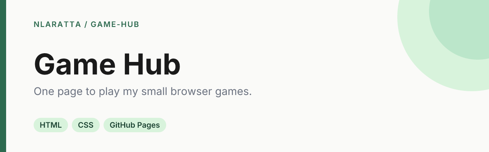

<p align="center">
  
</p>

<p align="center">
  <a href="https://github.com/nlaratta/game-hub/actions/workflows/ci.yml"></a>
  <a href="LICENSE"></a>
  <a href="https://nlaratta.github.io/game-hub/"></a>
</p>

A landing page for the small browser games I build, with one card per game, each linking to play it and to its source.

**[Open the Game Hub](https://nlaratta.github.io/game-hub/)**

## Quick start

It's static HTML, CSS and JavaScript with no build step:

```bash
git clone https://github.com/nlaratta/game-hub.git
cd game-hub
python3 -m http.server 8000   # then open http://localhost:8000
```

## Adding a game

1. Deploy the game somewhere public. Each of my games is its own repo on GitHub Pages.
2. Add a 16:10 screenshot to `assets/games/`.
3. Add an entry to `GAMES` in [`js/games.js`](js/games.js) with its title, blurb, play URL, source URL, image and tags.

Pushes to `main` run CI and deploy to GitHub Pages.

## License

[MIT](LICENSE) © Noah Laratta
